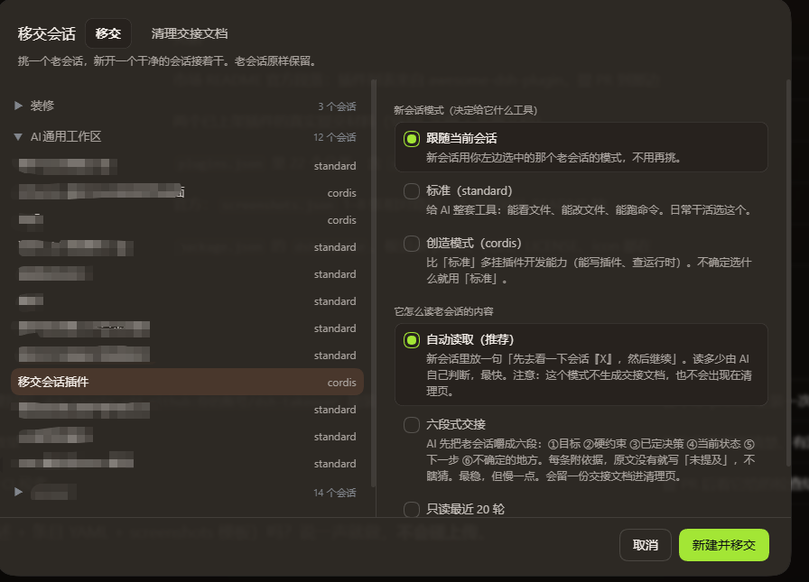
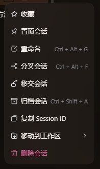
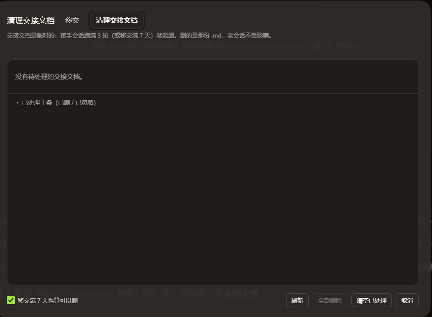

# dsh-takeover

> 在任意会话上右键「移交会话」，挑一个老会话，新开一个**上下文干净**的会话接着干——老会话原样保留，新会话开局就知道之前干了什么。

[](#)
[](#)
[](#)



---

## 这是什么

AI 会话聊久了会越来越长，越聊越贵、越聊越慢、越聊注意力越不集中，容易出错。以往要么硬着头皮继续，要么新建会话再手动喂一遍上下文。

`dsh-takeover` 把这件事做成一次点击：

1. 右键任意会话 →「移交会话」
2. 左边选要交接的老会话，右边选「新会话用什么模式」和「它怎么读老会话」
3. 点「新建并移交」

新会话会以干净上下文开局，但输入框里已经预填好交接指令；接手会话读完老会话后会把要点写进一份 `.md`，并在跑够几轮后提示你那份文档可以清掉了。

**老会话全程不动。**

---

## 功能

- **右键菜单入口**：`移交会话`，带图标；有待清理的交接文档时右侧显示红色数字

  
- **三种读取方式**
  - `自动读取`：只给一句「先去看一下会话 X」，读多少由 AI 自己决定（最快，不产生文档）
  - `六段式交接`：AI 先把老会话嚼成目标 / 硬约束 / 已定决策 / 当前状态 / 下一步 / 不确定的地方六段（最稳）
  - `只读最近 20 轮`：老会话很长、只关心最近的事时用
- **新会话模式跟随**：可以「跟随当前会话」，也可以手动选标准 / 创造模式
- **交接文档落盘**：写进 `AI工作区\交接\交接_<老会话>_<时间>.md`，开头带老会话 ID、移交时间、接手会话 ID
- **清理页**（弹窗里的第二个标签）
  - 按**工作区**分组、默认收起，组头显示绿点（可删几份）/ 红点（缺文档几份）
  - 接手会话**跑满 3 轮**（或移交满 7 天，可开关）→ 该文档标记为可删
  - 支持逐条删除、【全部删除】（只删现在能删的）、【清空已处理】记录
  - 每条都能【打开文件夹】跳到**它自己那个工作区**的交接目录
- **全部逻辑在主进程**：删文件、写记录、数轮数都在 DSH 主进程里做；窗口那一半只负责画界面和发请求

  

---

## 环境要求

| 项 | 要求 | 说明 |
|---|---|---|
| DSH | 桌面版（NEXT 系） | 需要 `webServer` 服务、`session/event` 事件、Electron `shell.openPath` |
| 系统 | Windows | 用了 `explorer.exe` / `cmd.exe` 兜底打开目录 |
| Node | 无需额外安装 | 只用 DSH 自带的内置模块 |
| 第三方依赖 | **无** | `package.json` 没有任何 dependencies |
| 技能 / Skill | **不需要** | 不依赖任何 skill |
| 模型 / API Key | **不需要** | 插件不调模型、不碰密钥 |

---

## 安装

### 方式一：从 npm 装（推荐）

```sh
dsh plugin --profile desktop add dsh-takeover
```

装完重启 DSH，右键任意会话就能看到「移交会话」。

> 国内网络建议走这条路：它只访问 npm 源，不需要连 GitHub 的下载通道。

### 方式二：本地 link（离线 / 开发用）

> 以下命令以 `DSH_HOME` 表示 DSH 数据目录（通常是 `%USERPROFILE%\.dsh`，迁移过的话以实际为准）。

**1. 放插件本体**

```powershell
Copy-Item ".\dsh-takeover" "$env:DSH_HOME\local-plugins\dsh-takeover" -Recurse
```

**2. 在 profile 里登记**

编辑 `$env:DSH_HOME\profiles\desktop\package.json`：

```json
{
  "dependencies": {
    "dsh-takeover": "link:$env:DSH_HOME/local-plugins/dsh-takeover"
  },
  "dsh": {
    "profile": {
      "bundles": [
        "dsh-takeover"
      ]
    }
  }
}
```

（`dependencies` 与 `bundles` 两处都要加，路径按你机器上的真实位置改。）

**3. 建目录链接**

```powershell
cmd /c mklink /J "$env:DSH_HOME\profiles\desktop\node_modules\dsh-takeover" "$env:DSH_HOME\local-plugins\dsh-takeover"
```

**4. 重启 DSH**

插件列表里出现 `dsh-takeover` 即为装好。
### 卸载

```powershell
cmd /c rmdir "$env:DSH_HOME\profiles\desktop\node_modules\dsh-takeover"
Remove-Item "$env:DSH_HOME\local-plugins\dsh-takeover" -Recurse
# 再从 profile 的 package.json 里删掉那两行
```

---

## 使用

### 移交一个会话

1. 右键任意会话 →「移交会话」
2. 左栏按工作区分组，展开后选一个老会话
3. 右栏选两样：
   - **模式**：跟随当前会话 / 标准 / 创造模式
   - **它怎么读老会话**：自动读取 / 六段式交接 / 只读最近 20 轮
4. 点「新建并移交」——会新建会话、切过去、并把交接指令预填进输入框
5. 在输入框按回车，接手会话开始工作

### 清理交接文档

1. 右键 →「移交会话」→ 切到「清理交接文档」标签
2. 按工作区展开，看每条的状态
3. 满足条件后点【删除】；没有文档的那些可以点【忽略】

---

## 数据存在哪

| 内容 | 位置 |
|---|---|
| 交接文档 | `<老会话所在工作区>\AI工作区\交接\交接_<标题>_<时间>.md` |
| 移交记录 | `<老会话所在工作区>\AI工作区\交接\移交记录.json` |
| 7 天开关 | 浏览器 localStorage 的一个键（`dsh-takeover:clean-settings`） |

**插件从不读写 DSH 的会话文件**，只通过宿主公开的快照和事件取数据。

---

## 目录结构

```
dsh-takeover/
├── package.json          # 插件清单（无第三方依赖）
├── cordis.patch.yml      # 挂进 profile 的 bundle 补丁
├── README.md             # 本文件
└── lib/
    ├── index.js          # 主进程半：记录、数轮数、删文件、开文件夹、HTTP 接口
    └── client.js         # 窗口半：右键菜单项 + 弹窗（移交 / 清理 两页）
```

---

## 常见问题

**Q：移交后没看到交接文档？**
看看你选的是哪种读取方式——「自动读取」**不产生文档**，也不进清理页。要文档就选「六段式交接」或「只读最近 20 轮」。

**Q：清理页显示「轮数未知」？**
那个接手会话还没跑过（或主进程重启前跑过）。去那个会话里正常聊天，跑满 3 轮后点【刷新】就会变成可删。

**Q：点【打开文件夹】没反应？**
会先试 Electron 的 `shell.openPath`，再退 `explorer.exe /n`，最后 `cmd /c start`。三种都失败时 toast 会列出各自报错，并把路径复制到剪贴板。

**Q：文档全删了，`移交记录.json` 要删吗？**
不用。它是「哪条还能删、哪条缺文档」的唯一依据，删了界面就不知道还有什么事，磁盘上的孤儿文件也找不回来。想瘦身用清理页的【清空已处理】。

---

## 许可

MIT。

作者：维庸化石（不识幻庵）

> 本项目的修改权限仅归作者本人。详见 `lib/index.js` 文件头的作者保留声明。
